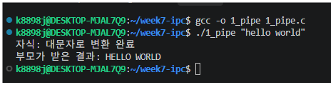
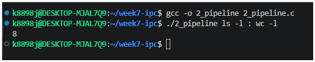
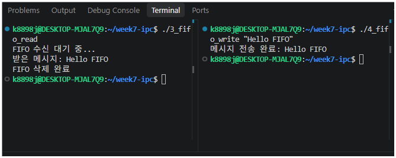

프로젝트 설명
파이프를 이용한 부모·자식 프로세스 간 양방향 통신, dup2()를 이용한 명령어 연결, FIFO를 이용한 독립 프로세스 간 메시지 통신을 구현하는 실습 프로그램을 만들어보았다.

실행화면 캡쳐
, , 

이번 실습을 통해 Linux 환경에서 파이프와 FIFO를 이용한 프로세스 간 통신을 구현하는 방법을 학습하였다.

또한 AI를 개념 이해와 오류 진단에 활용하되, 코드의 동작 원리를 스스로 설명하고 실행 결과를 검증하는 과정이 중요하다는 점을 배웠다.